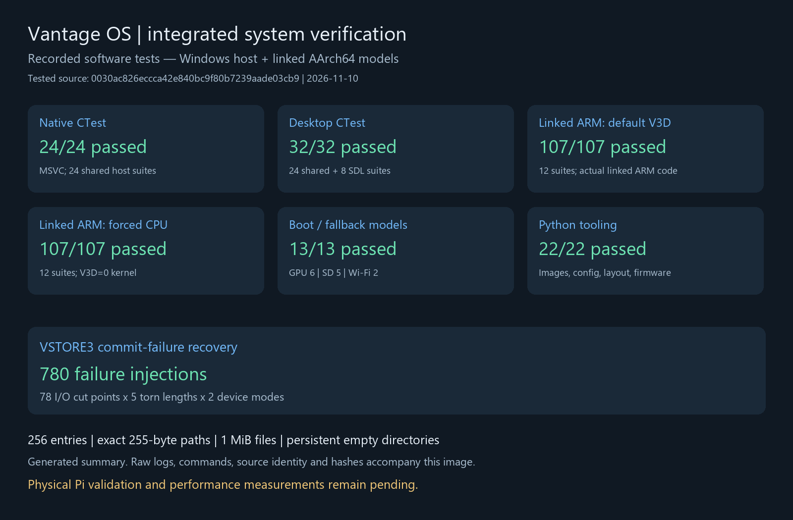
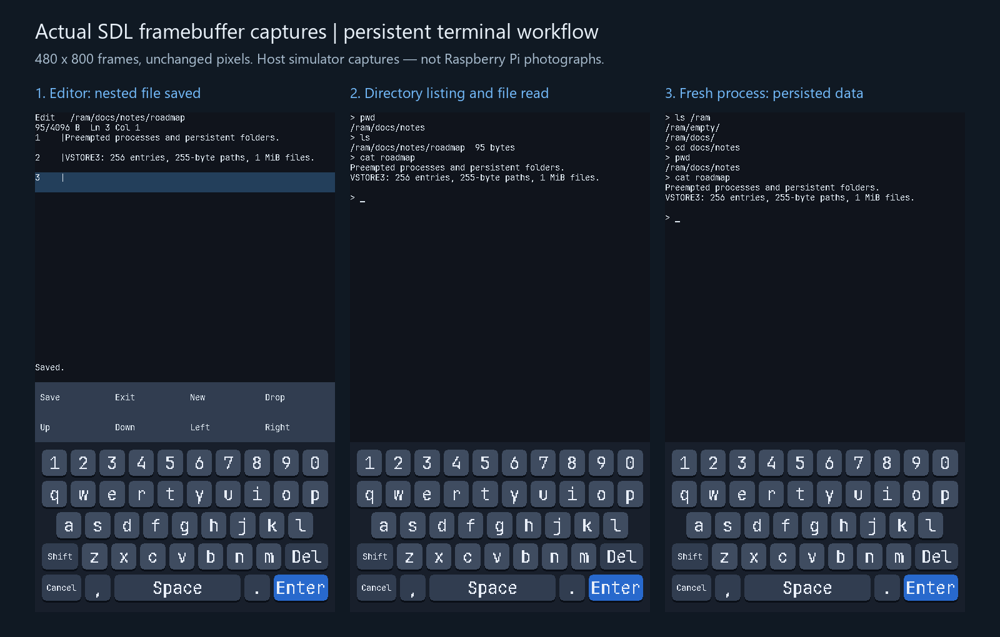

# Integrated system validation

Recorded source: [`0030ac826eccca42e840bc9f80b7239aade03cb9`](https://github.com/Rennex07/Vantage-OS/commit/0030ac826eccca42e840bc9f80b7239aade03cb9).
This is the production-code commit tested below. Subsequent evidence changes
add this record, its graphics generator and documentation clarification.

These are **Windows host tests, SDL application captures and linked AArch64
software models**. Physical Raspberry Pi acceptance and performance measurements
remain pending. GitHub Actions runs the final PR head separately on Linux;
its run page and downloadable artifacts provide the independent CI record.



## Results and raw evidence

| Run | Result | Evidence |
|---|---|---|
| Headless native CTest | 24/24 | [Output](records/host-junit.txt), [JUnit](host.xml) |
| Desktop CTest | 32/32: the same 24 shared tests plus 8 SDL integration tests | [Output](records/simulator-junit.txt), [JUnit](simulator.xml) |
| Default V3D image, linked ARM | 107/107 across 12 suites | Per-suite records below |
| Forced-CPU image, linked ARM | 107/107 across the same 12 suites | Per-suite records below |
| V3D boot/fallback model | 6/6 | [Output](records/v3d-boot.txt) |
| Storage boot configuration | 5/5 | [Output](records/storage-boot.txt) |
| Unavailable/disabled Wi-Fi assets | 2/2 | [Output](records/wifi-boot.txt) |
| Python tools | 22/22 | [Output](records/tool-tests.txt) |
| V3 crash recovery | 78 I/O cut points × 5 torn lengths × 2 device modes = 780 failure injections | [Output](records/v3-crash-recovery.txt), [test implementation](../../../tests/native/fs/capacity.c) |
| Actual SDL editor / fresh-process readback | Passed | [Output](records/sdl-frame-capture.txt), capture provenance in [results.json](results.json) |

Native CTest already includes Python-tool, scheduler, filesystem and driver
tests. Desktop CTest repeats those native tests. Counts in this table are not
summed into an inflated unique-test total.

### Linked ARM suites

| Suite | Cases per image | Default V3D | Forced CPU |
|---|---:|---|---|
| Firmware memory discovery and MMU setup | 14 | [Log](records/arm-memory_management.txt) | [Log](records/cpu-memory_management.txt) |
| Secondary startup and boot gates | 12 | [Log](records/arm-secondary_startup.txt) | [Log](records/cpu-secondary_startup.txt) |
| Interrupt vectors, timer and trap frames | 9 | [Log](records/arm-interrupts.txt) | [Log](records/cpu-interrupts.txt) |
| Process lifecycle and address spaces | 11 | [Log](records/arm-processes.txt) | [Log](records/cpu-processes.txt) |
| Timer preemption and migration | 6 | [Log](records/arm-preemption.txt) | [Log](records/cpu-preemption.txt) |
| Embedded EL0 terminal | 5 | [Log](records/arm-terminal.txt) | [Log](records/cpu-terminal.txt) |
| Kernel task lifecycle | 14 | [Log](records/arm-tasks.txt) | [Log](records/cpu-tasks.txt) |
| Four-core task ownership | 7 | [Log](records/arm-task_smp.txt) | [Log](records/cpu-task_smp.txt) |
| Persistent files and EL0 file syscalls | 14 | [Log](records/arm-files.txt) | [Log](records/cpu-files.txt) |
| V3 capacity and long-path ABI | 5 | [Log](records/arm-capacity.txt) | [Log](records/cpu-capacity.txt) |
| Pi driver adapters | 4 | [Log](records/arm-pi4_drivers.txt) | [Log](records/cpu-pi4_drivers.txt) |
| SD storage adapter | 6 | [Log](records/arm-storage.txt) | [Log](records/cpu-storage.txt) |

The capacity suite exercises 256 real entries, exact 255-byte paths through
isolated EL0 syscalls, growth beyond the old 4096-byte limit, cross-sector
overwrites and remount, a 1 MiB file's last byte and EOF bound, and invalid
mapping permissions. An inaccessible syscall buffer terminates its process;
misalignment is an ordinary file error.

The preemption model counts instructions, not wall time. Its pending-syscall
test checks that expired calls complete and the pending interrupt is taken only
at EL0; it does not establish an exact post-SVC interrupt instruction or a real
10 ms hardware interval.

## Build configurations

Each build below completed with the production strict warnings enabled:

| Configuration | Build record |
|---|---|
| Default `V3D=1`, `WIFI=1`, `STORAGE=1`, missing assets/config safely skipped | [Default](records/arm-build.txt) |
| Forced CPU, `V3D=0` | [CPU](records/cpu-build.txt) |
| `V3D=0 WIFI=0 STORAGE=0` | [All disabled](records/all-disabled-build.txt) |
| Ordinary mount configured with explicit clock/partition | [Normal storage](records/normal-storage-build.txt) |
| Opt-in strict storage validation | [Validation storage](records/validation-storage-build.txt) |
| Supplied synthetic Wi-Fi fixture | [Asset generation](records/synthetic-wifi-assets.txt), [compile-only build](records/synthetic-wifi-compile-only.txt) |

The fixture bytes are not radio firmware and were never used as evidence of
wireless operation. The storage test clock is a model input, not a recommended
physical-board setting. Default and CPU kernel image SHA-256 values and every
command's exit status are recorded in [results.json](results.json).

## Real simulator captures



These are direct `SDL_RenderReadPixels` captures of the actual application and
renderer, driven by SDL keyboard/touch events. Pillow performs lossless BMP-to-PNG
conversion and adds the montage's surrounding captions; it does not draw or
replace the terminal contents. Original frame dimensions are 480×800.

- [Editor frame](terminal.editor.png): `/ram/docs/notes/roadmap`, after Save.
- [Folder frame](terminal.folders.png): current directory, typed listing and file readback.
- [Fresh-process frame](terminal.reboot.png): a second simulator process mounts
  the same V3 image and reads the exact saved document and persistent empty directory.

The capture test also checks file bytes through the kernel file API and validates
the on-disk namespace through the independent image inspector. Original BMP,
PNG-file and RGB-pixel hashes are retained in [results.json](results.json).
The screenshots demonstrate the host application workflow, not ARM isolation,
physical SD durability or V3D hardware execution; those software checks have
separate logs above.

Reproduce the captures after building the simulator:

```sh
python tests/tools/terminal_capture_roundtrip.py /path/to/terminal_capture --output out/captures
```

Use a new output directory. The executable is normally
`<build>/sim/terminal_capture` or, on Windows multi-config builds,
`<build>/sim/Release/terminal_capture.exe`. The test chooses SDL's dummy video
driver and software renderer and creates its own disposable regular-file image.

## Reproduction

Host/compiler versions for the recorded local runs:

- Windows x64; MSVC 19.51.36243.0.
- Python 3.14.7, CMake 4.4.3, SDL2 2.32.10.
- Arm GNU Toolchain 15.2.Rel1, GCC 15.2.1.
- Unicorn 2.1.4 and Capstone 5.0.7.

```sh
python tools/build.py test --build-dir out/host
python tools/build.py sim --sdl /path/to/SDL2 --build-dir out/desktop
ctest --test-dir out/desktop -C Release --output-on-failure

python tools/build.py --build-dir out/arm
python tools/build.py --build-dir out/cpu --v3d 0
python -m pip install unicorn==2.1.4 capstone==5.0.7

for build in arm cpu; do
  for suite in memory_management secondary_startup interrupts processes preemption terminal tasks task_smp files capacity pi4_drivers storage; do
    python -B "tests/arm/$suite.py" "out/$build/kernel8.elf" -v
  done
done

python -B tests/arm/v3d_boot.py out/arm/kernel8.elf out/cpu/kernel8.elf -v
```

The loop uses a POSIX shell; individual Python commands work in PowerShell too.
Full argument vectors for storage/Wi-Fi boot variants are in their linked logs.
The Actions workflow additionally runs Linux ASan/UBSan tests and a separate
UBSan scheduler run, because ASan does not fully support `ucontext` switching.
Local Windows results above do not claim sanitizer coverage.

To regenerate only the documentation graphics from the recorded manifest and
lossless source frames (Pillow is optional documentation tooling, not a kernel
or simulator build dependency):

```sh
python -m pip install Pillow==12.3.0
python tools/render_validation.py --results docs/validation/system-integration/results.json
```

The renderer rejects failed recorded commands and verifies each frame's pixel
hash before composing it. `summary.png` is explicitly a **generated results
visualization**, not a screenshot of tests executing. Read the raw records for
the underlying assertions and results.

## CI evidence and limitations

The `Memory management` workflow uploads:

- **`kernel-native-validation`**: native/scheduler JUnit, individual logs for both
  ARM images, boot/fallback logs, tool versions and kernel hashes.
- **`simulator-validation`**: SDL CTest JUnit, capture-test output, three original
  BMP frames and `capture.json`.

Artifacts are retained for 30 days and are uploaded even on failure. The
committed local records here remain available independently. Private absolute
paths and the local machine hostname are normalized in the committed copies;
test names, results, diagnostic output, counts and timings are preserved.

The failure-injection device model assumes completed syncs are durable and a
failed write changes only its addressed sector. Real SD controllers/FTLs can
violate those assumptions under power loss. Timer/GIC firmware handoff,
cross-core cache/TLB hardware behavior, real GPU domain/reset/scanout handling,
radio firmware/association, and physical SD persistence still require the
acceptance procedures in [SCHEDULER.md](../../SCHEDULER.md),
[HARDWARE.md](../../HARDWARE.md) and [STORAGE.md](../../STORAGE.md).
